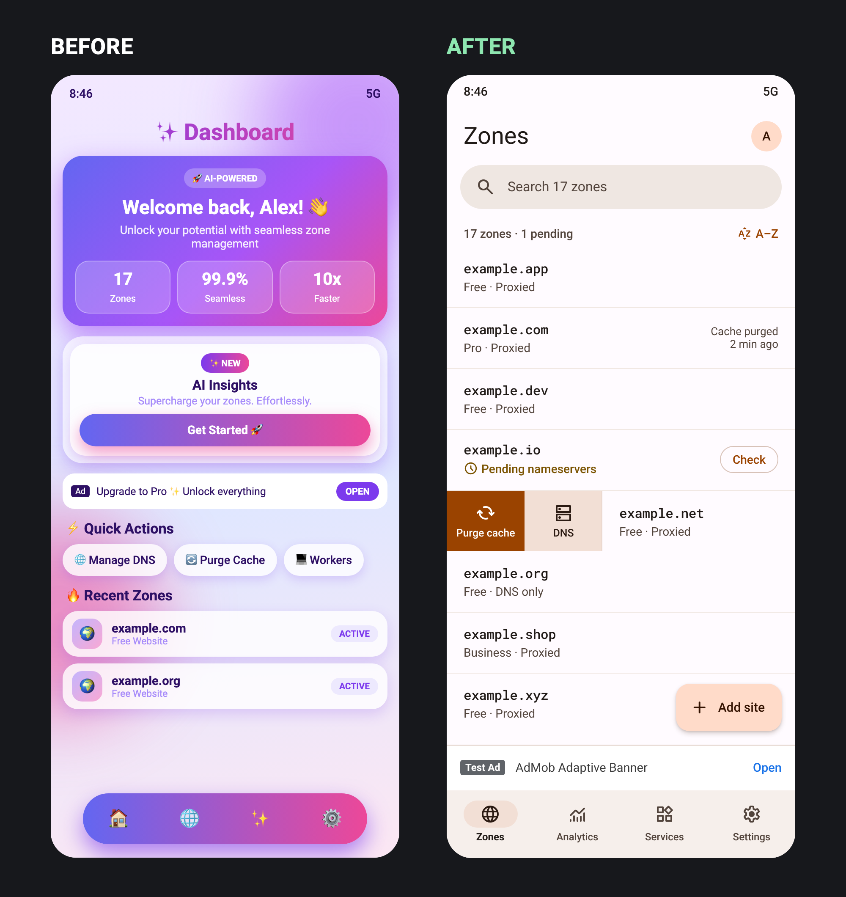

# unslopovich

**Your app looks AI-generated. Dr. Unslopovich noticed.**

Users don't hate your purple gradient. They hate what you did to the back button.



<sub>Dramatization. Your app may be worse.</sub>

```bash
npx unslopovich
```

Then tell your agent:

```text
/unslopovich review my app
```

## The doctor did the reading

Dr. Unslopovich scanned 105,027 App Store reviews from 299 top apps. Exactly one mentioned a purple gradient. It was asking for one.

Here's what made people furious instead, in the 46,742 reviews rated 3 stars or lower:

- **You made it slow.** 4,326 reviews about lag, glitches, and crashes.
- **You moved the button.** 1,751. Telegram's Contacts tab. Chrome's back arrow. Instagram's hold to pause.
- **You interrupted them.** 1,148. Popups in the middle of ordering food.
- **You hid everything.** 859 said it was hard to find or use.
- **You put AI where the feature was.** 705. Gemini in the toolbar. Alexa in the search box.
- **You never tried it on their phone.** 345 about broken layouts.

<sub>Most recent reviews from the US and UK App Stores. Keyword matches, so treat them as rough. Themes can overlap.</sub>

So the doctor checks what users actually scream about first, and your gradient second.

The biggest bucket is the one no design review can see: you can't read lag off a screenshot. The doctor flags what code gives away, like lists that render every row up front, and every report says **Not profiled** until someone actually profiles it. A clean review is not a clean bill of health.

## Symptoms

- Controls that moved, vanished, or do nothing
- AI features blocking the thing people came to do
- Numbers and labels that lie
- Website in a phone: hamburger menus, hero sections, fake tab bars
- Cards inside cards inside cards
- The tasteful default: white cards, thin gray borders, one blue accent, a colored dot beside every label
- Emoji pretending to be icons
- Stat tiles with numbers nobody measured
- The keyboard sitting on top of the input
- "Oops! Something went wrong"
- "Unlock your potential"

## Appointments

```text
/unslopovich review the home screen     diagnosis and a score out of 24, no edits
/unslopovich treat checkout             diagnose, fix, verify, before and after
/unslopovich scan src/                  quick code-only pass with the detector
/unslopovich chart                      write down your top tasks and brand rules once
/unslopovich follow-up home             re-check and compare with the last visit
```

The chart lives in `.unslopovich/chart.md`. It's where you tell the doctor that the gradient is the brand, so it stops bringing it up.

## The detector

Twenty-one rules that read SwiftUI, UIKit, Compose, Android XML, React Native, Flutter, and Ionic source. No model, no network, no dependencies. The skill runs it for you, and it works on its own too:

```bash
npx unslopovich detect src/
npx unslopovich detect --json ios/ android/   # for agents and CI
npx unslopovich detect --list-rules           # every rule and its fix
```

It catches purple gradients and the project template's leftover purple, nested cards, decorative status dots, gradient text, glow shadows, emoji icons, unvirtualized lists, text that ignores the user's font size, disabled back gestures, hamburger menus, hover in a touch app, keyboards covering inputs, invented stats, and "Oops! Something went wrong".

Exit code `2` means findings, so it can gate a pull request. Silence one line with `// unslopovich-ignore <rule-id>`, or a whole rule in `.unslopovich/config.json`:

```json
{ "ignoreRules": ["status-dot"], "ignorePaths": ["src/legacy/"] }
```

It reads code, not screens. Most of what users complain about, a moved button, a popup in the way, a slow list, only shows up in the running app, which is why the skill looks at that first.

## Bedside manner

> Three gradients, two hamburgers, no back button. I have questions.

> This card contains a card. That card contains a sparkle. Remove all three.

> "Seamless" is not a feature.

Sample verdicts. Yours may be worse.

## Treats

SwiftUI, UIKit, Jetpack Compose, React Native, Expo, Flutter, Ionic, Capacitor, Angular Native, and NativeScript.

It reads your theme, finds the problems, fixes the shared components first, and uses your platform's native building blocks. It won't move your users' favorite button without asking.

It also won't trade your purple gradient for the other default, the calm white one every model reaches for. A treated screen has to pass one test: cover the logo, and it should still look like your app.

Only want the bad news? Ask for a review and it stops at the diagnosis.

## Other agents

Installs for Claude Code by default. The skill is `SKILL.md` plus a `reference/` folder it reads on demand and the detector in `scripts/`. For any other agent that reads `SKILL.md`, point it at that agent's skills folder:

```bash
npx unslopovich --dir ~/path/to/skills
```

## License

MIT
